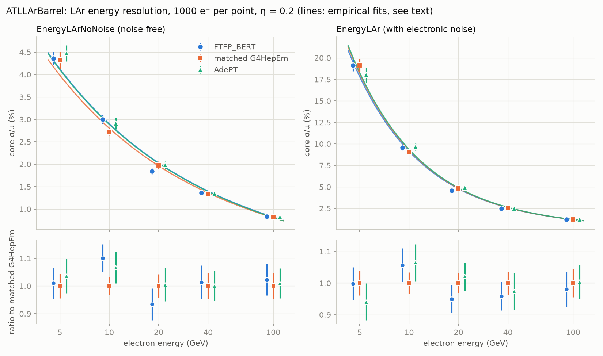
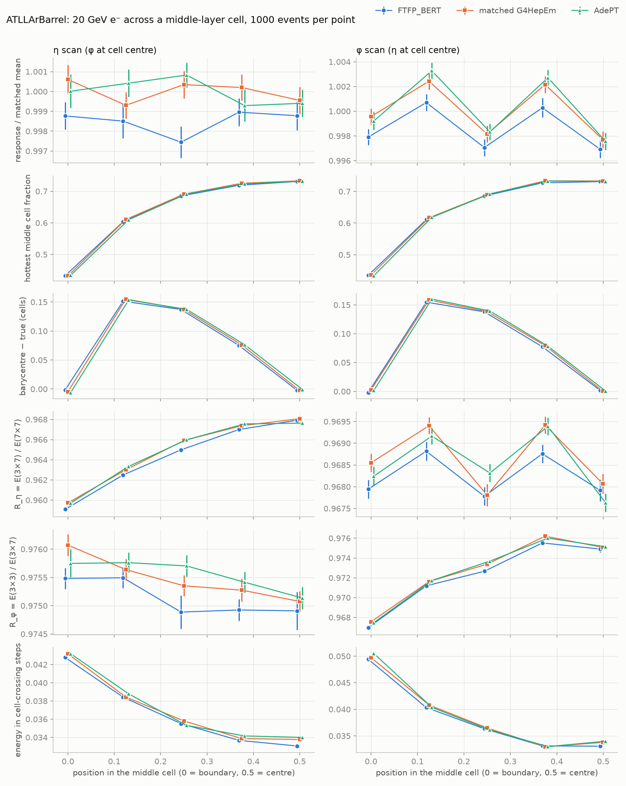

# Results

Validation and performance of ATLLArBarrel with AdePT (e-, e+ and gamma on the GPU) against two CPU references,
plus checks of the sensitive detector, the geometry and the materials. Section 1 is the current validation
(2026-11-23). The earlier measurements of October–November 2026, including the investigation of the production-cut
problem, are kept in [Appendix A](#appendix-a-earlier-measurements). Build options are described in
[BUILD_OPTIONS.md](BUILD_OPTIONS.md).

## Environment

| Component | Version / setting |
|---|---|
| Host | EL9, AMD Ryzen 9 3900 (12 cores, 24 threads), glibc 2.34, gcc 13.3 (gcc-toolset-13) |
| GPU | NVIDIA GeForce RTX 2070 SUPER (compute capability 7.5, 8 GB), driver 590.48, also driving the desktop display |
| CUDA | 13.1 |
| Geant4 | 11.4.3, Release, multithreaded, builtin expat |
| G4HepEm | commit `780e798` (tracking-manager mode only), built with `G4HepEm_CUDA_BUILD=ON` and `G4HepEm_EARLY_TRACKING_EXIT=ON` |
| VecCore / VecGeom | 0.8.2 / 2.2.0 (CUDA, GDML, scalar backend, `VECGEOM_NAV=index` unless stated) |
| AdePT | 0.4.2 (`c0220ec`) |
| GeoModel | 6.33.0 (section 4 only) |

`EnergyLAr` is the energy per event in the LAr sensitive detector, Birks-corrected and including the electronic noise
(20 MeV equivalent per cell, i.e. 4 MeV in the LAr, on all 1792 cells: about 169 MeV rms on the sum).
`EnergyLArNoNoise` is the same without noise, `EnergyLArNoBirks` without noise and without Birks correction. Since
2026-11-23 the ntuple also has the cells without noise (`FrontHitsEdepNoNoise`, `MiddleHitsEdepNoNoise`,
`BackHitsEdepNoNoise`) and two boundary diagnostics, `EnergyCrossCell` and `EnergyCrossSection`: the energy of the
steps whose post-step point lies in another cell, or another section, than the pre-step point that receives the whole
deposit (section 1g). The runs of 1a–1f were taken before; the code change does not change their events. All
energies are in MeV. Errors on means are standard errors of the mean. Times are the event-loop times printed by
Geant4 at the end of the run (initialisation excluded).

## 1. Electron validation, 5–100 GeV (2026-11-23)

1000 electrons per energy (5, 10, 20, 40 and 100 GeV) from the origin towards η = 0.2, φ = 0.01225, production cut
0.01 mm set before `/run/initialize`, 8 threads, fixed seeds. Three setups:

- **FTFP_BERT**: the default CPU build.
- **matched**: `-DWITH_G4HepEm=ON -DWITH_G4HepEmEM=ON`: FTFP_BERT with its EM constructor replaced by
  `G4EmStandardPhysics` + `G4HepEmTrackingManager` for e-, e+ and gamma, without multiple MSC steps per
  transportation step. It is the same EM physics as AdePT, on the CPU: **the reference that tests the GPU transport**.
- **AdePT**: `-DWITH_ADEPT=ON` (built from the top of AdePT_examples), e-, e+ and gamma on the GPU in all regions,
  energy-loss fluctuations on.

The 15 runs were executed one after the other on an otherwise idle machine, so the times are not disturbed by other
runs. All runs ended without `G4Exception`; every sample has 1000 events with 1000 different `EventID`s, and
`HadInteraction` is 0 (electron beams).

**Reproduce:** macros, driver script and instructions are in [`runcards/validation/`](runcards/validation/README.md):

```sh
CPU_EXE=<build-cpu>/ATLLArBarrel MATCHED_EXE=<build-hepemem>/ATLLArBarrel ADEPT_EXE=<build-adept>/ATLLArBarrel \
  runcards/validation/run_validation.sh <output-dir>
python3 analysis/resolution.py <output-dir> --plot resolution.png
```

The script writes the tables of 1a and 1b (`analysis/estats.py`), the times and a record of the environment. The
macros fix the Geant4 seeds (the same for the three setups at one energy) and the GPU seed.

### 1a. Mean LAr energy

`EnergyLArNoNoise`:

| E (GeV) | FTFP_BERT | matched | AdePT | AdePT − matched | AdePT − FTFP_BERT |
|---|---|---|---|---|---|
| 5 | 939.9 ± 1.5 | 939.7 ± 1.5 | 940.5 ± 1.4 | **+0.8 ± 2.1 (+0.08 %, 0.4 σ)** | +0.6 ± 2.0 (+0.07 %, 0.3 σ) |
| 10 | 1924.1 ± 2.0 | 1931.5 ± 1.8 | 1928.3 ± 1.9 | **−3.3 ± 2.6 (−0.17 %, −1.2 σ)** | +4.2 ± 2.8 (+0.22 %, 1.5 σ) |
| 20 | 3920.3 ± 2.6 | 3920.6 ± 2.7 | 3923.7 ± 2.6 | **+3.1 ± 3.8 (+0.08 %, 0.8 σ)** | +3.4 ± 3.7 (+0.09 %, 0.9 σ) |
| 40 | 7907.1 ± 5.5 | 7916.0 ± 5.3 | 7927.0 ± 3.5 | **+11.0 ± 6.3 (+0.14 %, 1.7 σ)** | +19.9 ± 6.5 (+0.25 %, 3.1 σ) |
| 100 | 19909.3 ± 7.7 | 19928.3 ± 7.3 | 19942.1 ± 6.6 | **+13.8 ± 9.8 (+0.07 %, 1.4 σ)** | +32.8 ± 10.1 (+0.16 %, 3.2 σ) |

- **AdePT agrees with the matched CPU reference** at all five energies, within 1.7 σ (at most 0.17 %). The same
  holds for `EnergyLAr` (with noise) and `EnergyLArNoBirks`.
- Against FTFP_BERT, AdePT is 3 σ higher at 40 and 100 GeV (+0.16 to +0.25 %), and so is the matched reference
  (+0.11 % and +0.10 %). This is the difference between the G4HepEm and the Geant4 EM physics, already seen at
  50 GeV in [A3e](#a3e-adept-against-the-matched-g4hepem-cpu-reference-2026-11-19), not a GPU effect.

### 1b. Longitudinal shower shape

Energy in the three compartments (sum of the cells, with noise) and front fraction Front / (Front + Middle + Back),
per event. AdePT − matched:

| E (GeV) | Front (MeV) | Middle (MeV) | Back (MeV) | Front fraction |
|---|---|---|---|---|
| 5 | −6.7 ± 7.3 (−0.9 σ) | +5.3 ± 6.4 (0.8 σ) | +3.2 ± 2.9 (1.1 σ) | −0.0098 ± 0.0069 (−1.4 σ) |
| 10 | +2.9 ± 9.9 (0.3 σ) | −1.0 ± 9.8 (−0.1 σ) | −0.9 ± 2.9 (−0.3 σ) | +0.0015 ± 0.0049 (0.3 σ) |
| 20 | −4.4 ± 14.6 (−0.3 σ) | +8.0 ± 15.1 (0.5 σ) | +6.6 ± 2.9 (2.3 σ) | −0.0020 ± 0.0037 (−0.5 σ) |
| 40 | +10.4 ± 25.0 (0.4 σ) | −1.2 ± 25.9 (−0.0 σ) | −2.1 ± 3.2 (−0.7 σ) | +0.0013 ± 0.0032 (0.4 σ) |
| 100 | −29.0 ± 48.2 (−0.6 σ) | +44.8 ± 47.6 (0.9 σ) | −4.0 ± 5.3 (−0.8 σ) | −0.0016 ± 0.0024 (−0.7 σ) |

All 20 differences are within 2.3 σ, with no trend in energy, as expected from statistical fluctuations (one of 20
above 2 σ). No difference in the longitudinal shower shape is seen. The compartments include the noise, so the
front fraction is not a noise-free observable. (The runs of this section were taken before the noise-free cells were
added to the ntuple; section 1g uses them.)

### 1c. Energy resolution

Relative resolution σ/μ of the LAr energy (`analysis/resolution.py`). σ/μ divides out the sampling fraction, so no
calibration is needed. **Core**: mean and standard deviation of the events within μ ± 2σ, iterated, with σ
corrected for the truncation of a Gaussian at ±2σ; it is insensitive to the rare low-energy tail. Errors are
bootstrap standard deviations (300 resamplings).



Core σ/μ of `EnergyLArNoNoise`, %:

| E (GeV) | FTFP_BERT | matched | AdePT |
|---|---|---|---|
| 5 | 4.36 ± 0.14 | 4.32 ± 0.19 | 4.47 ± 0.18 |
| 10 | 3.00 ± 0.10 | 2.73 ± 0.09 | 2.91 ± 0.12 |
| 20 | 1.85 ± 0.08 | 1.98 ± 0.09 | 1.99 ± 0.08 |
| 40 | 1.36 ± 0.05 | 1.34 ± 0.06 | 1.34 ± 0.04 |
| 100 | 0.83 ± 0.03 | 0.81 ± 0.04 | 0.82 ± 0.02 |

Empirical fits, as weighted linear fits in (σ/μ)², E in GeV (B is not constrained to be positive):

| Setup | a (% √GeV), noise-free: (σ/μ)² = a²/E + B | B (%²) | c (GeV), with noise: + c²/E², a and B fixed |
|---|---|---|---|
| FTFP_BERT | 9.28 ± 0.20 (χ² 10.1/3) | −0.19 ± 0.06 (−3.1 σ) | 0.866 ± 0.017 (χ² 9.5/4) |
| matched | 8.95 ± 0.22 (χ² 3.7/3) | −0.15 ± 0.08 (−1.8 σ) | 0.885 ± 0.018 (χ² 2.5/4) |
| AdePT | 9.24 ± 0.22 (χ² 6.1/3) | −0.20 ± 0.06 (−3.3 σ) | 0.892 ± 0.019 (χ² 1.8/4) |

- **The three setups agree in resolution within the errors.** The ratios to the matched reference are compatible with 1 at all
  energies, and the sampling terms agree within 1.1 σ.
- **The noise term matches the noise model.** The expected value is 169 MeV / (μ/E) = 0.868 GeV; the fits give
  0.87–0.89 GeV.
- **The fit is empirical, not a measurement of a constant term.** B comes out negative for the three setups, by
  1.8–3.3 σ: between 5 and 100 GeV the resolution falls slightly faster than 1/√E, so a/√E ⊕ b does not describe
  the curve, and no constant term b (value or limit) is derived from it. The fit is used only to summarise each
  curve with the same function; the comparison rests on the resolution points and their ratios, and on a, which
  agrees within 1.1 σ. Measuring a constant term would need a model that describes the data and a stated confidence
  procedure, which this comparison does not need.
- The errors on c are conditional on a and B fixed from the noise-free fit: they do not include the uncertainty of
  that fit or its correlations.
- This is the resolution of the sum of all LAr cells for a fixed beam direction, with the simplified detector
  response of the example (constant field in Birks, independent Gaussian noise on all cells, no clustering or
  calibration). It is a comparison of the simulated response, not the resolution of a reconstructed ATLAS electron.

### 1d. Low-energy tail

Events with `EnergyLArNoNoise` below 80 % of the median. They come from photonuclear interactions of hard photons
(the hadrons deposit little in the LAr and part of the energy escapes, [A3b](#a3b-50-gev-electrons-150-events-8-threads-2-repetitions)).

| E (GeV) | FTFP_BERT | matched | AdePT |
|---|---|---|---|
| 5 | 2 | 5 | 1 |
| 10 | 1 | 0 | 0 |
| 20 | 0 | 0 | 0 |
| 40 | 2 | 1 | 0 |
| 100 | 0 | 0 | 0 |
| **total** | **5** | **6** | **1** |

The tail drives the rms: at 40 GeV the rms/mean is 2.18 % (FTFP_BERT) and 2.11 % (matched) against 1.39 % (AdePT),
while the core resolution is the same (1.34–1.36 %). The counts are small: summed over the energies, 1 event against
6 (matched) in equal samples of 5000 events gives p = 0.12 in a two-sided Fisher test, so the difference is not
significant, but these counts cannot show that the tail rates are equal either. Section 1e repeats the 40 GeV point
with 10000 events.

### 1e. 40 GeV with 10000 events

Same macros with `/run/beamOn 10000` (`EVENTS=10000 ENERGIES=40 runcards/validation/run_validation.sh <dir>`), same
seeds, so the first events overlap with the 1000-event sample. All runs ended without `G4Exception`, 10000 distinct
`EventID`s each.

| | FTFP_BERT | matched | AdePT | AdePT − matched | AdePT − FTFP_BERT |
|---|---|---|---|---|---|
| EnergyLArNoNoise (MeV) | 7913.7 ± 1.4 | 7922.5 ± 1.3 | 7924.2 ± 1.2 | **+1.7 ± 1.8 (+0.02 %, 1.0 σ)** | +10.5 ± 1.8 (+0.13 %, 5.7 σ) |
| EnergyLAr (MeV) | 7911.7 ± 2.2 | 7921.3 ± 2.1 | 7923.8 ± 2.1 | +2.5 ± 3.0 (+0.03 %, 0.9 σ) | +12.2 ± 3.0 (+0.15 %, 4.0 σ) |
| Front fraction | 0.2599 ± 0.0007 | 0.2610 ± 0.0007 | 0.2613 ± 0.0007 | +0.0003 ± 0.0010 (0.3 σ) | +0.0014 ± 0.0010 (1.4 σ) |
| Core σ/μ, noise-free (%) | 1.358 ± 0.015 | 1.358 ± 0.016 | 1.361 ± 0.016 | | |
| rms/mean, noise-free (%) | 1.72 ± 0.08 | 1.61 ± 0.07 | 1.54 ± 0.05 | | |
| Event-loop time | 1395 s | 1028 s | 1148 s | | |

- **Mean and resolution:** AdePT agrees with the matched reference to 0.02 % (1.0 σ) in the mean and to 0.2 % in the
  core resolution. The difference to FTFP_BERT is now significant (5.7 σ) and is the same for the matched reference
  (+0.11 %): it is the G4HepEm vs Geant4 EM physics.
- **Tail: no significant difference observed; the precision on rare events is limited.** Events below a fraction of
  the median, for several thresholds (counts out of 10000; p: two-sided Fisher test, AdePT against matched; ratio:
  AdePT/matched rate, 95 % interval from the conditional binomial, Clopper–Pearson):

  | Threshold | 0.95 | 0.90 | 0.85 | 0.80 | 0.70 | 0.60 |
  |---|---|---|---|---|---|---|
  | FTFP_BERT | 49 | 17 | 16 | 8 | 3 | 1 |
  | matched | 44 | 10 | 6 | 5 | 1 | 1 |
  | AdePT | 29 | 9 | 6 | 1 | 1 | 0 |
  | p, AdePT vs matched | 0.10 | 1.00 | 1.00 | 0.22 | 1.00 | 1.00 |
  | AdePT/matched rate, 95 % interval | 0.40–1.08 | 0.32–2.5 | 0.27–3.7 | 0–1.8 | 0.01–79 | 0–39 |

  No threshold shows a significant difference, but the intervals are wide: at 0.80 and below, a factor of 2 or more
  between the two tail rates is not excluded, and at 0.95 the AdePT rate is lower by about a third (p = 0.10). The
  thresholds are nested, so the six columns are correlated and not independent tests. A Kolmogorov–Smirnov test of
  the full noise-free distributions gives p = 0.70 for AdePT against matched (and p = 0.0004 for matched against
  FTFP_BERT, the EM-physics difference): this is a consistency check of the whole distribution, which a few tail
  events hardly change, not a test of the tail. Showing that the tail rates are equal would need an explicit
  equivalence goal (the rate difference to exclude) and the statistics to reach it. The lower rms/mean of AdePT
  comes from a few events and is compatible within the errors.

### 1f. Time per run

Event-loop time for 1000 events, 8 threads, runs one after the other:

| E (GeV) | FTFP_BERT | matched | AdePT | AdePT speed-up vs FTFP_BERT | vs matched |
|---|---|---|---|---|---|
| 5 | 18.7 s | 14.3 s | 59.4 s | 0.32 | 0.24 |
| 10 | 37.3 s | 27.8 s | 71.3 s | 0.52 | 0.39 |
| 20 | 74.0 s | 54.9 s | 88.4 s | 0.84 | 0.62 |
| 40 | 146.5 s | 108.8 s | 114.8 s | 1.28 | 0.95 |
| 100 | 366.8 s | 265.3 s | 190.0 s | **1.93** | **1.40** |

The CPU time grows linearly with the energy (about 3.7 s per GeV for FTFP_BERT and 2.7 s per GeV for the matched
reference), while AdePT grows much more slowly: below 20 GeV the GPU is underused with 8 threads and the run is slower
than on the CPU; AdePT overtakes FTFP_BERT between 20 and 40 GeV and the matched reference at about 40 GeV. These are
single measurements on a consumer GPU that also drives the display (see Caveats).

### 1g. Position scan across a middle cell (2026-11-23)

20 GeV electrons, 1000 events per point and setup, 8 threads, with the noise-free cells and the boundary
diagnostics added to the ntuple on the same day. The beam direction moves from a cell boundary (position 0) to the
centre (0.5) of a middle-layer cell (Δη = 0.025, Δφ = 2π/256) in steps of 1/8 cell: an η scan at the φ centre and a φ
scan at the η centre (`runcards/validation/scan/`, README there). η = 0.2, the direction of the energy points, is a
cell boundary in η of all three layers; φ = 0 is a boundary in φ of all three layers. All 27 runs ended without
`G4Exception`.

```sh
SCAN=1 CPU_EXE=... MATCHED_EXE=... ADEPT_EXE=... runcards/validation/run_validation.sh <scan-dir>
python3 analysis/scan.py <scan-dir> --plot scan.png
```



Per point, from the noise-free cells: the response (mean `EnergyLArNoNoise`, relative to the matched mean of the
scan), the fraction of the middle-layer energy in its hottest cell, the 3×3 barycentre minus the true direction (in
cells), R_η = E(3×7)/E(7×7) and R_φ = E(3×3)/E(3×7) around the hottest middle cell, and the fraction of the energy
in steps that end in another cell (`EnergyCrossCell`) or another section (`EnergyCrossSection`). The full tables
with errors are printed by `analysis/scan.py`. Selected values, matched G4HepEm and AdePT:

| Observable (matched / AdePT) | boundary (0) | centre (0.5) | AdePT − matched, worst of the 10 points |
|---|---|---|---|
| Hottest-cell fraction, η scan | 0.4326 / 0.4343 | 0.7329 / 0.7316 | −0.0021 ± 0.0014 (−1.5 σ, φ boundary) |
| Barycentre − true at 1/8 cell (cells), η scan | 0.155 / 0.154 at 0.125 | −0.003 / −0.001 | +0.0016 ± 0.0007 (2.1 σ, at the centre) |
| R_η, η scan | 0.9597 / 0.9597 | 0.9681 / 0.9676 | +0.0005 ± 0.0003 (1.5 σ) |
| R_φ, φ scan | 0.9676 / 0.9675 | 0.9751 / 0.9751 | +0.0004 ± 0.0003 (1.3 σ) |
| Energy in cell-crossing steps, φ scan | 4.97 % / 5.05 % | 3.38 % / 3.40 % | +0.08 ± 0.03 % (2.6 σ, at the boundary) |
| Energy in section-crossing steps, φ scan | 0.366 % / 0.377 % | 0.376 % / 0.379 % | +0.011 ± 0.004 % (2.6 σ, at the boundary) |

- **The cell response is the same on CPU and GPU.** The sharing between cells (0.43 of the middle energy in the
  hottest cell on a boundary, 0.73 at the centre), the position bias of the barycentre (the usual S-shape, up to
  0.16 cell towards the centre), R_η and R_φ follow the same curves for the three setups. Of the 70 AdePT − matched
  differences (7 observables × 10 points), 3 are above 2 σ and none above 2.6 σ. This count is descriptive, not a
  global test: the two scans share their centre point (9 simulated points, 10 entries), and the observables of one
  point are correlated with each other.
- **The accordion is navigated the same way on the GPU.** In φ the response oscillates by ±0.3 % with a period of
  1/4 cell, from the accordion folds, and R_η follows the same pattern; AdePT reproduces the pattern of the matched
  reference point by point (within 0.9 σ in the response).
- **Steps crossing a boundary.** 3.3–5.0 % of the LAr energy is in steps that end in another cell, most at a cell
  boundary, and about 0.4 % in steps that end in another section. The example gives the whole deposit of such a step
  to its pre-step cell; the fractions show how much energy this concerns, and that it is the same on CPU and GPU
  within 3 % of its size. They are not a measured scoring error: they identify the steps that may be affected, and
  measuring the bias of the approximation would need a study with subdivided steps, which the example does not
  include. The scan therefore tests that CPU and GPU agree with the same simplified scoring, not how close that
  scoring is to the ATLAS one. The two 2.6 σ differences (AdePT 1.6 % and 3 % higher in the two crossing fractions)
  are at the same point, φ = 0, a φ boundary of all three layers, and are correlated with each other; among 70
  comparisons they are not significant on their own, but they are the place to look first with more statistics.
- FTFP_BERT differs from the two G4HepEm setups in the response (−0.1 %, as in 1a) and slightly in R_η and R_φ: the
  EM-physics difference again.

## 2. Sensitive detector and step transfer from GPU to CPU

AdePT copies the GPU steps back to the CPU and calls the unchanged Geant4 sensitive detector, under two
conditions in its documentation: user code must not cache per-track state in shared members, and it must
not kill tracks.

**The ATLLArBarrel sensitive detector meets these conditions.** It is created per worker in
`ConstructSDandField` and attached to `LAr::EMB::STAC`. `ProcessHits` keeps no per-track state and uses only
the pre-step position, the total energy deposit and the step length, which are all copied from the GPU.
AdePT drains the returned steps before the end of the event. Checks on the copied steps (2026-11, with the cut before init, before the validation of section 1):

| Check | Result |
|---|---|
| 300 events of 50 GeV electrons, about 95 million sensitive-detector calls | every step in the sensitive volume reaches it |
| Energy per event, sensitive detector against a sum over the same steps | identical in all events |
| Distance between pre- and post-step point larger than the step length | 0 steps |
| Electron energy deposit larger than its kinetic energy | 0 steps |
| 5 GeV gamma, default mode against all steps returned, events without a nuclear reaction | 89 of 89 agree within the print precision |

In events with a nuclear reaction the two modes differ by up to 17 MeV at 5 GeV and 26 MeV at 50 GeV, with a mean
of -0.06 and -0.13 MeV. These reactions use CPU random numbers, whose sequence depends on the order of the
returned steps, but this explanation has not been isolated. All 50 GeV events contain at least one reaction.

**AdePT limitation: nuclear secondaries have ParentID 0 by default.** Unless the host keeps the track data
(`/adept/returnFirstAndLastStep true`, `/adept/returnAllSteps true`), GPU tracks are reconstructed on the CPU with
the dummy track ID 0. Hadrons created by a photonuclear or electronuclear reaction on a GPU step then get
**ParentID 0, the same value as a real primary**, and Geant4 user code cannot tell them apart from primaries by
ParentID. Their tracking on the CPU is otherwise normal, so energies and hits are not affected. The dummy track ID
appears in a comment of the AdePT code, but the AdePT user documentation does not mention this effect.

`HadInteraction` selected primaries with `GetParentID()==0`, so it was wrongly set with AdePT. The tracking action
now identifies primaries by their attached `G4PrimaryParticle`, which does not depend on the track IDs:

| Sample | Setup | Events with `HadInteraction` = 1 |
|---|---|---|
| 50 GeV e-, 150 events | CPU FTFP_BERT | 0 |
| | AdePT, default, previous code | 135 |
| | AdePT, `/adept/returnFirstAndLastStep true`, previous code | 0 |
| | AdePT, default, fixed code | 0 |
| 5 GeV gamma, 300 events | AdePT, default, fixed code | 0 |
| 20 GeV pi-, 300 events | CPU FTFP_BERT, fixed code | 253 |
| | AdePT, default, fixed code | 253 |

The pion sample confirms that the flag still works for real primaries. Its mean energy without noise is
1412.5 ± 61.8 MeV with AdePT and 1371.5 ± 61.9 MeV on the CPU, compatible with each other (0.5 sigma) with a large
error. Returning the first and last steps took 20.5 s against 20.4 s for 150 electrons (one run).

## 3. VecGeom navigation state: `tuple` vs `index`

AdePT `example1` with its default macro: CMS 2018 geometry, 1 event with 200 electrons of 10 GeV,
transported on the GPU. VecGeom recommends `VECGEOM_NAV=index` for this geometry (navigation table
about 264 MB, below its 512 MB threshold).

| `VECGEOM_NAV` | Run time | Total deposited energy |
|---|---|---|
| `tuple` (default) | 2.60 s (1 run) | 899.66 GeV |
| `index` | 2.42 s, 2.39 s (2 runs) | 899.41 GeV (identical in both runs) |

`index` is about **8 % faster**. The small energy difference comes from a different random sequence.

## 4. Geometry overlap checks

Tolerance 10 um, 200 random points per volume.

| Geometry checked | Tool | Overlaps |
|---|---|---|
| `GDMLs/experimentalHall_v0p1.gdml` converted with GeoModel `gdml2gm` | `gmclash -t 0.01 -n 200` | 3749 |
| `GDMLs/experimentalHall_v0p1.gdml` (original) | `gmclash -t 0.01 -n 200` | 1 |
| Original geometry (`legacy/src`, 17808 volumes) (17808 volumes) | `geometry_test.mac` (Geant4 `/geometry/test/run`) | 1 (same volume) |
| Fixed geometry (`src`, 8904 volumes), tolerance 1 µm, 20000 and 200000 points per volume | Geant4 `/geometry/test/run` (`Review.md` 4.6) | **0** |

- 3748 of the 3749 overlaps in the converted geometry are artefacts of the GDML -> GeoModel
  conversion, all in the EMB accordion. Straight sections are reported about 1.56 m outside their
  mother `STAC`, and folds overlap straight sections by a constant 2.2 mm (absorbers) and 0.27 mm
  (electrodes). The converted geometry should not be used.
- The single real overlap: the first cathode `catho3` of presampler module `mod[1]` (electrodes
  tilted by −12°) protrudes by about **1.0 mm** from `LAr::Barrel::Presampler::Module`.
  The tilted cathode spans ±1.47 mm in the stacking direction, but its centre is only 0.44 mm from
  the module edge (margin `mod[1][5] = 0.3 mm` + half thickness + `epsil`). It was fixed on 2026-11-19 in `src/`,
  together with 6–30 µm overlaps of five thin-absorber straight sections found at higher resolution (`Review.md`,
  section 4); the original geometry is kept in `legacy/src` (`-DWITH_LEGACY_GEOMETRY=ON`).

## 5. Material definitions

The material table (`/material/g4/printMaterial all`) was compared before and after the
introduction of `MaterialManager` (NIST elements, no duplicated materials):

- All densities are unchanged. Duplicate-material warnings went from 8 to 0.
- Radiation lengths changed by less than 0.15 % because of the NIST elements (largest: `Cables`,
  5.825 -> 5.817 cm).

Two pre-existing bugs were then fixed. They change the physics, and all the measurements above
were taken after these fixes:

| Material | Before | After |
|---|---|---|
| `Gten` (unit `g/cm` instead of `g/cm3`) | 180 g/cm3, X0 = 2.2 mm | 1.8 g/cm3, X0 = 22.3 cm |
| `SiO2` (uses the Gten density) | 180 g/cm3 | 1.8 g/cm3 |
| `MBoards` (mixture with Gten) | 155 g/cm3, X0 = 2.5 mm | 2.85 g/cm3, X0 = 7.1 cm |
| `Cables` (mass fractions 62 % + 39 % = 101 %) | 3.003 g/cm3 | Kapton 38 %: 3.035 g/cm3 |

## Caveats

- The GPU is a consumer card with low FP64 throughput (AdePT computes in double precision), and it also drives the
  desktop display. GPU times are not representative of data-centre GPUs.
- The LAr energy is the sum of all cells with a simplified response (constant field in Birks, fixed sampling
  fraction for the noise, independent Gaussian noise on all cells). It is not a reconstructed ATLAS energy.
- The validation uses electrons only, at one beam direction (η = 0.2) for the energy points and across one middle
  cell for the position scan (section 1g); there is no hadron or pile-up workload. What the example does not cover
  (presampler scoring, touchable-based channel mapping, hit times, ancestry, mixed CPU/GPU regions) is listed in the
  [README](README.md#scoring-with-adept-from-step-to-plot).
- With the default (fixed) seeds, repeated runs give the same events, both on CPU and with AdePT, up to the last bit
  of the per-event sums with AdePT and several threads (most likely the steps returned from the GPU are summed in a
  different order). Repetitions therefore do not measure event-to-event variation.
- The validation of 1a–1f was taken before the noise-free cell vectors existed; only section 1g uses them.

## Appendix A: earlier measurements

Measurements of October–November 2026, before the validation of section 1. They are kept because they document
how the AdePT integration was validated and, in A3c, how the production-cut problem
([AdePT#745](https://github.com/apt-sim/AdePT/issues/745)) was found. Section 1 supersedes their physics and timing
comparisons. **Many AdePT rows below were taken with `/run/setCut` after `/run/initialize`, so the GPU did not use
the requested production cut: only the rows marked "cut before init" compare the same physics.**
They use the macros of `runcards/benchmarks/` (with `/run/setCut` after `/run/initialize` in the CPU macros at the
time, which does not matter on the CPU), and before 2026-11-19 the original geometry (`legacy/src`, section 4 and
`Review.md`).

**The six figures of this appendix are archived evidence of the investigation, not reproducible outputs of this
example.** They were made with the earlier analysis script of the review, which was not kept, and figures 3, 4 and 5
need a diagnostic build (all GPU steps returned, per-step and per-track information) that is not part of this
repository. Their caveats are given under each one. The reproducible plots are those of section 1.

### How these measurements were taken

Build the three configurations in separate directories, as described in [BUILD_OPTIONS.md](BUILD_OPTIONS.md):
`build-cpu` (default), `build-hepem` (`-DWITH_G4HepEm=ON`) and `build-adept` (`-DWITH_ADEPT=ON`).
Run from the build directory, after sourcing `geant4.sh`:

| Section | Command |
|---|---|
| A1a | `./ATLLArBarrel -m ../runcards/benchmarks/gamma5GeV.mac -t 1` (in `build-cpu` and `build-hepem`) |
| A1b | `./ATLLArBarrel -m ../runcards/benchmarks/electron50GeV.mac -t 1` (in `build-cpu` and `build-hepem`) |
| A3a | `build-cpu`: `gamma5GeV.mac -t 1`; `build-adept`: `gamma5GeV_adept.mac -t 1` |
| A3b | `build-cpu`: `electron50GeV.mac -t 8`; `build-adept`: `electron50GeV_adept.mac -t 8` |
| A3e | `build-cpu`, `build-hepemem` (`-DWITH_G4HepEm=ON -DWITH_G4HepEmEM=ON`) and `build-adept`: `electron50GeV*.mac` and `gamma5GeV*.mac` with `/run/beamOn 10000`, `-t 8` |
| 4 | `build-cpu`: `./ATLLArBarrel -m ../runcards/benchmarks/geometry_test.mac -t 1` |

Section 3 uses AdePT's own `example1` (`example1.mac`) built with `VECGEOM_NAV=tuple` and `index`.
The energy statistics are computed from `ATLLArBarrelout_Run0.root` with `analysis/estats.py` (needs `uproot` and
`numpy`). For A3e:
`python3 analysis/estats.py FTFP_BERT=build-cpu/ATLLArBarrelout_Run0.root matched=build-hepemem/ATLLArBarrelout_Run0.root AdePT=build-adept/ATLLArBarrelout_Run0.root --diff AdePT-matched --diff AdePT-FTFP_BERT`.
The script was rewritten on 2026-11-23 from the definitions stated on this page (the review's original was not kept);
the tables below were produced with the original and have not been recomputed.
With the default (fixed) seeds, repeated runs give the same energy distributions, both on CPU
and with AdePT, up to floating-point rounding. With AdePT and 8 threads, per-event energies can
differ in the last bit, at most 6·10⁻¹⁶ relative (measured on 2026-11-19), most likely because the
steps returned from the GPU are summed in a different order. Means, rms and minima are unchanged to
all the digits quoted here.

### A1. G4HepEm vs Geant4 FTFP_BERT (CPU)

- **FTFP_BERT**: Geant4 reference physics list (EM + hadronic).
- **G4HepEm**: `-DWITH_G4HepEm=ON`, i.e. `PhysListHepEmTracking` from `hepemlib/`: only the
  `G4HepEmTrackingManager` for e-, e+ and gamma (no hadronic physics), `MscRangeFactor = 0.04`.

#### A1a. 5 GeV gamma, 300 events, 1 thread, 3 sequential repetitions

| Physics | Time per event | EnergyLAr mean (MeV) |
|---|---|---|
| FTFP_BERT | 136.7 ± 0.2 ms | 977.2 ± 10.1 (rms 175) |
| G4HepEm | 95.0 ± 2.0 ms | 964.3 ± 10.6 (rms 184) |

Speed-up **1.44** (−30.5 % time per event). The deposited energies are compatible (0.9 sigma).

#### A1b. 50 GeV electrons, 150 events, 1 thread, 3 repetitions run concurrently

| Physics | Time per event | EnergyLAr mean (MeV) |
|---|---|---|
| FTFP_BERT | 1407 ± 2 ms | 9912.7 ± 15.7 (rms 192) |
| G4HepEm | 975 ± 1 ms | 9938.4 ± 17.7 (rms 216) |

Speed-up **1.44** (−30.7 %). The deposited energies are compatible (1.1 sigma).
The speed-up is the same as at 5 GeV, because the time is dominated by EM shower tracking.

### A3. AdePT (GPU) vs Geant4 FTFP_BERT (CPU)

- **AdePT**: `-DWITH_ADEPT=ON`: FTFP_BERT with the EM constructor replaced by
  `G4EmStandardPhysics_AdePT`, equivalent to AdePT's `FTFP_BERT_AdePT`. e-, e+ and gamma are
  transported on the GPU in all regions (1 M track slots, 1 M hit slots). GPU steps are returned
  to the CPU and processed by the unchanged ATLLArBarrel sensitive detector. Since 2026-11-19 the project
  uses its own constructor `ATLLArBarrelEmPhysics_AdePT`: same physics, with the settings of the `*_adept.mac`
  macros as defaults in code (AdePT_migration.md, step 2, option B). With this constructor
  `electron50GeV_adept.mac` reproduces the results of A3b on the same machine.
- **CPU**: the default build, FTFP_BERT.

**Energy-loss fluctuations.** AdePT switches them off by default, while FTFP_BERT on the CPU has them
on. The `*_adept.mac` macros now set `/adept/SetEnergyLossFluctuation true`, which is confirmed by the
G4HepEm configuration printed at initialisation. Below, "AdePT (fl. off)" are the earlier measurements,
which do not compare the same physics as the CPU, and "AdePT (fl. on)" are the matched ones. The runs
with fluctuations on, the noise-free values and the CPU re-runs of 2026-11-10 use the current code. A
re-run with fluctuations off on the current code reproduces the earlier EnergyLAr means exactly.

**Order of `/run/setCut` (important).** The `*_adept.mac` macros originally called `/run/setCut 0.01 mm` after
`/run/initialize`. With AdePT this order does not give the requested production cut on the GPU
(A3c), so the rows labelled "fl. off" and "fl. on" below are not valid physics comparisons. Rows
labelled "cut before init" have `/run/setCut` before `/run/initialize`, as the macros do now, and they
are the reference AdePT results. The CPU runs are not affected.

#### A3a. 5 GeV gamma, 300 events, 1 thread

| Setup | Time per event | CPU time / wall time | EnergyLAr mean (MeV) |
|---|---|---|---|
| CPU FTFP_BERT | 136.7 ± 0.2 ms (A1a) | ~100 % | 977.2 ± 10.1 (rms 175) |
| AdePT (fl. off) | 142 ± 3 ms (3 runs) | ~26 % | 979.7 ± 9.9 (rms 171) |
| AdePT (fl. on) | 159.7 ± 0.4 ms (3 runs) | ~25 % | 969.5 ± 10.4 (rms 180) |
| **AdePT (fl. on, cut before init)** | 232.0 ± 1.9 ms (3 runs) | ~24 % | 960.5 ± 10.3 (rms 179) |

There is no gain: with the production cut applied, AdePT is **1.7x slower** than the CPU here. With a single CPU thread and one 5 GeV shower at a time the GPU is underused,
and the CPU thread waits for it about 75 % of the time. A later CPU re-run gave 141.8 ms per event,
so run-to-run variation on this machine is about 4 %. The mean energies agree within the
statistical precision of this sample (±1.4 %). The electronic noise dominates this error. Without it:

| EnergyLArNoNoise (MeV) | Mean | rms | Min |
|---|---|---|---|
| CPU FTFP_BERT | 970.7 ± 2.9 | 50.6 | 701.2 |
| AdePT (fl. off) | 981.8 ± 2.8 | 48.3 | 854.5 |
| AdePT (fl. on) | 986.7 ± 3.0 | 52.1 | 618.1 |
| **AdePT (fl. on, cut before init)** | 973.4 ± 2.6 | 45.2 | 834.5 |

With the cut before init, AdePT agrees with the CPU at 5 GeV: **+2.7 ± 3.9 MeV (+0.3 %, 0.7 sigma)**.
With the cut after init the difference was +16.0 ± 4.2 MeV (+1.6 %, 3.8 sigma) with fluctuations on and
+11.1 ± 4.0 MeV (+1.1 %, 2.8 sigma) with fluctuations off.

#### A3b. 50 GeV electrons, 150 events, 8 threads, 2 repetitions

| Setup | Wall time | Throughput (time per event) |
|---|---|---|
| CPU FTFP_BERT | 28.99 s, 28.46 s | 191.5 ± 2.5 ms |
| AdePT (fl. off) | 12.87 s, 12.19 s | 83.5 ± 3.2 ms |
| CPU FTFP_BERT, re-run on the current code | 28.53 s, 28.54 s | 190.2 ms |
| AdePT (fl. on), 3 repetitions | 13.90 s, 13.64 s, 13.69 s | 91.6 ± 0.9 ms |
| **AdePT (fl. on, cut before init), 3 repetitions** | 20.31 s, 20.45 s, 20.37 s | 135.9 ± 0.5 ms |

With the matched physics and the production cut applied, AdePT is **1.4x faster** in throughput. The
2.1x (fluctuations on) and 2.3x (fluctuations off) speed-ups were measured with the cut after init, so they
do not compare the same physics. An earlier run with 160 events and fluctuations off gave 183 ms (CPU)
and 81 ms (AdePT).


*Archived figure. Energy, particle and thread count all change between the panels, so the dependence on the shower
size is not isolated, and the speed-ups with the cut after init compare different physics. Section 1f has the
comparison at the same physics and thread count, with the matched reference.*

| EnergyLAr (MeV) | Mean | Median | rms | Min |
|---|---|---|---|---|
| CPU FTFP_BERT | 9912.7 ± 15.7 | 9925.2 | 192 | 9308.5 |
| AdePT (fl. off) | 9990.4 ± 35.6 | 10028.7 | 436 | 5386.7 |
| AdePT (fl. off), without the event below 8 GeV | 10021.3 ± 17.9 | – | 219 | – |
| AdePT (fl. on) | 10017.0 ± 40.1 | 10063.8 | 491 | 4555.0 |
| AdePT (fl. on), without the event below 8 GeV | 10053.6 ± 16.3 | – | 198 | – |
| **AdePT (fl. on, cut before init)** | 9899.0 ± 19.0 | – | 232 | 8374.2 |

| EnergyLArNoNoise (MeV) | Mean | Median | rms | Min |
|---|---|---|---|---|
| CPU FTFP_BERT | 9913.8 ± 9.9 | 9932.1 | 121 | 9437.7 |
| AdePT (fl. off) | 10016.3 ± 31.5 | 10052.0 | 385 | 5672.4 |
| AdePT (fl. off), without the event below 8 GeV | 10045.4 ± 11.9 | – | 146 | – |
| AdePT (fl. on) | 10021.1 ± 38.1 | 10064.2 | 467 | 4622.2 |
| AdePT (fl. on), without the event below 8 GeV | 10057.4 ± 11.8 | – | 145 | – |
| **AdePT (fl. on, cut before init)** | 9920.7 ± 13.2 | – | 161 | 8472.5 |

With the cut before init the 50 GeV mean agrees with the CPU within the statistics of this sample
(+6.9 ± 16.5 MeV without noise).


*Archived figure. 1000 events in 100 MeV bins, compared with FTFP_BERT only and including the configuration with the
wrong cut. Sections 1a–1c compare the response and resolution with the matched reference, with errors and ratios.*

**Events at about half the typical energy are physics.** With the cut after init, event 1 deposits
4622 MeV without noise (fluctuations on) and event 145 deposits 5672 MeV (fluctuations off). A diagnostic
build that returned all GPU steps and summed the energy per event showed:

- Every event below 8 GeV (events 1 and 372 with fluctuations on, event 145 with fluctuations off) contains
  a photonuclear interaction of a 29-35 GeV photon. The hadrons deposit little in the LAr, and 9-18 GeV of
  non-electromagnetic particles leave the world.
- The energy budget closes: deposits plus escaping energy average 49879 MeV with AdePT (cut before init)
  and 49881 MeV on the CPU, with 1000 events each.
- With 1000 electrons and the cut before init, no event is below 8 GeV. The lowest one deposits 8473 MeV
  and contains a 29.5 GeV photonuclear interaction. The CPU has none below 8 GeV, and its lowest event
  (8734 MeV) contains a 19.2 GeV photonuclear interaction.
- With 4000 photons of 30 GeV each, the tails are compatible within the limited statistics: photonuclear
  interactions above 25 GeV occur 5 times with AdePT (cut before init) and 3 times on the CPU, with energies of
  0.24-0.75 and 0.22-0.59 of the typical value. Events below 70 % of the typical value number 3 and 4, all with a
  photonuclear interaction above 10 GeV. A handful of events cannot show that the tail probabilities are equal;
  section 1e compares the tails with 10000 events and several thresholds.


*Archived figure, from the diagnostic build. The "typical value" and the selection of the events shown (54 and 56 of
4000 in the legend) are not documented, and the selection cannot be reconstructed from this repository. It supports
photonuclear interactions as the mechanism of the low tail, not equal tail rates.*

#### A3c. Origin of the AdePT excess: order of `/run/setCut`

With `/run/setCut` after `/run/initialize`, AdePT deposited about 1.4 % more energy in the LAr than the CPU.
Moving the command before `/run/initialize` removes this excess. The comparison below uses a diagnostic
build, 1000 electrons of 50 GeV, 8 threads and fluctuations on. The "G4HepEm on CPU" setups replace only the
EM constructor of FTFP_BERT, so they use the G4HepEm physics with the Geant4 navigation. "AdePT settings"
disables the multiple MSC steps per transportation step, as AdePT does on the GPU. The values exclude events
with a photonuclear interaction above 1 GeV or more than 500 MeV of escaping non-EM energy.

| Setup | EnergyLArNoNoise (MeV) | Before Birks (MeV) | After/before Birks | Steps per event | e± steps in LAr | e± path in LAr (mm) | e± path in absorber (mm) |
|---|---|---|---|---|---|---|---|
| CPU FTFP_BERT | 9917.1 ± 4.0 | 9978.6 ± 4.0 | 0.9938 | 817985 | 163205 | 52131 | 31621 |
| G4HepEm on CPU, default | 9907.6 ± 3.8 | 9966.5 ± 3.8 | 0.9941 | 637319 | 104966 | 52117 | 31432 |
| G4HepEm on CPU, AdePT settings | 9935.2 ± 4.0 | 9996.5 ± 4.0 | 0.9939 | 788647 | 161753 | 52216 | 31403 |
| AdePT, cut after init | 10062.0 ± 4.1 | 10078.6 ± 4.1 | 0.9984 | 597269 | 82462 | 51041 | 29336 |
| **AdePT, cut before init** | 9931.7 ± 3.9 | 9992.8 ± 3.9 | 0.9939 | 791958 | 162949 | 52192 | 31418 |


*Archived figure: a diagnostic of the cut problem, with the event selection stated above the table. It shows that the
late cut changes both the energy sharing and the Birks response.*

- With the cut before init, AdePT is **+0.15 % ± 0.06 %** above the CPU, the same as G4HepEm on CPU with the same
  settings (+0.18 % ± 0.06 %). What remains is therefore the difference between the G4HepEm and FTFP_BERT physics,
  not a GPU effect. With the cut after init the difference was +1.46 % ± 0.06 %. Steps per event, Birks ratio and path
  lengths now also match G4HepEm on CPU.
- With the cut after init, the GPU produces 44 thousand electron tracks per event instead of 117 thousand. Only
  electrons below about 1 MeV are missing, while positrons and higher-energy electrons are unchanged. This is the
  behaviour expected from a higher production threshold.
- A run with no `/run/setCut` at all gives a mean of 10035 MeV without noise for 150 electrons, close to the 10021 MeV
  of the cut after init but not bit-identical. This is consistent with the GPU tables keeping the default cut, but the
  exact mechanism inside AdePT has not been identified.
- The total deposit in the detector is the same in all cases (about 49790 MeV), so energy was shared differently
  between absorber and LAr rather than lost.
- Reducing the MSC safety factor from 0.6 to 0.1 did not change the gap, so the GPU safety estimate was not the cause.


*Archived figure, from the diagnostic build. Counts per energy interval, with intervals of unequal width: not a
differential spectrum. It is evidence of a higher effective production threshold with the late cut, not a
detector-scoring observable. Below 10 keV FTFP_BERT differs from G4HepEm and AdePT, which overlap.*


*Archived figure, from the diagnostic build. Energy-weighted, in four broad step-length bins, without uncertainties:
it shows that the response depends on the step structure (relevant for Birks), but does not validate the step
structure in detail. Section 1g measures the energy in steps that cross a cell or section boundary.*

The macros `runcards/benchmarks/*_adept.mac` now set the cut before `/run/initialize`, so they reproduce the
cut-before-init rows. With the cut before init AdePT agrees with the CPU to better than 0.2 %, but it has only been
compared on these benchmarks (5 GeV gamma, 30 GeV gamma and 50 GeV electrons).

#### A3e. AdePT against the matched G4HepEm CPU reference (2026-11-19)

Measured with the fixed geometry (`src/`) and the current code, on the machine of this page. Three setups:

- **FTFP_BERT**: the default CPU build.
- **matched**: `-DWITH_G4HepEm=ON -DWITH_G4HepEmEM=ON`, i.e. FTFP_BERT with its EM constructor replaced by
  `G4EmStandardPhysics` + `G4HepEmTrackingManager` for e-, e+ and gamma: the same EM physics as AdePT, on the CPU.
- **AdePT**: built from the top of AdePT_examples, `*_adept.mac` macros.

All use the benchmark macros of `runcards/benchmarks/` with `/run/beamOn` changed as stated, and 8 threads.
`EnergyLArNoNoise` in MeV, errors are standard errors of the mean.

**MSC stepping must match.** G4HepEm on the CPU by default lets e-/e+ do several MSC steps within one
transportation step (`Multiple steps in MSC+Trans. : 1` in the G4HepEm printout). AdePT disables this on the
GPU (`AdePTConfiguration`, default `false`; the printout shows `0`). 1000 electrons of 50 GeV:

| Setup | EnergyLArNoNoise | vs FTFP_BERT | AdePT − setup |
|---|---|---|---|
| FTFP_BERT | 9911.8 ± 4.1 | – | +13.5 ± 5.9 (2.3 sigma) |
| matched, multiple MSC steps on (G4HepEm default) | 9900.9 ± 4.4 | −0.11 % | **+24.4 ± 6.2 (4.0 sigma)** |
| matched, multiple MSC steps off (as AdePT) | 9924.5 ± 5.8 | +0.13 % | **+0.7 ± 7.2 (0.1 sigma)** |
| AdePT | 9925.3 ± 4.3 | +0.14 % | – |

This is the same pattern as A3c ("G4HepEm on CPU, default" against "AdePT settings"). With the MSC
setting matched, the CPU reproduces AdePT. `WITH_G4HepEmEM` therefore disables the multiple MSC steps by default;
`-DWITH_G4HepEmEM_MSC_MULTISTEPS=ON` restores the G4HepEm default (BUILD_OPTIONS.md). The rows "matched" below use
the default (off).

**10000 events.** 50 GeV electrons and 5 GeV photons. The compartment energies (`FrontHitsEdep`,
`MiddleHitsEdep`, `BackHitsEdep`, summed over the cells) include the electronic noise, which has zero mean. The
front fraction is Front / (Front + Middle + Back), per event.

| 50 GeV e⁻, 10000 events | FTFP_BERT | matched | AdePT | AdePT − matched | AdePT − FTFP_BERT |
|---|---|---|---|---|---|
| EnergyLArNoNoise | 9915.0 ± 1.5 | 9922.7 ± 1.8 | 9924.0 ± 1.6 | **+1.4 ± 2.4 (+0.01 %, 0.6 sigma)** | +9.1 ± 2.2 (+0.09 %, 4.1 sigma) |
| EnergyLAr | 9915.8 ± 2.3 | 9919.4 ± 2.4 | 9925.4 ± 2.3 | +6.0 ± 3.4 (1.8 sigma) | +9.6 ± 3.2 (3.0 sigma) |
| Front | 2406.8 ± 6.6 | 2415.5 ± 6.7 | 2406.2 ± 6.6 | −9.3 ± 9.4 (−1.0 sigma) | −0.6 ± 9.3 (−0.1 sigma) |
| Middle | 7450.1 ± 6.7 | 7445.4 ± 6.9 | 7460.4 ± 6.8 | +15.0 ± 9.7 (+1.6 sigma) | +10.4 ± 9.5 (+1.1 sigma) |
| Back | 58.9 ± 0.8 | 58.4 ± 0.8 | 58.8 ± 0.8 | +0.3 ± 1.1 (+0.3 sigma) | −0.2 ± 1.1 (−0.1 sigma) |
| Front fraction | 0.2428 ± 0.0007 | 0.2437 ± 0.0007 | 0.2426 ± 0.0007 | −0.0011 ± 0.0010 (−1.1 sigma) | −0.0003 ± 0.0009 (−0.3 sigma) |
| rms / min of EnergyLArNoNoise | 148.2 / 6097.5 | 178.6 / 2967.6 | 160.7 / 2402.1 | | |

| 5 GeV γ, 10000 events | FTFP_BERT | matched | AdePT | AdePT − matched | AdePT − FTFP_BERT |
|---|---|---|---|---|---|
| EnergyLArNoNoise | 970.0 ± 0.5 | 971.2 ± 0.5 | 970.6 ± 0.5 | **−0.6 ± 0.7 (−0.06 %, −0.8 sigma)** | +0.6 ± 0.7 (+0.07 %, 0.9 sigma) |
| EnergyLAr | 969.1 ± 1.8 | 968.7 ± 1.8 | 971.3 ± 1.8 | +2.6 ± 2.5 (1.1 sigma) | +2.2 ± 2.5 (0.9 sigma) |
| Front | 362.9 ± 1.9 | 360.6 ± 1.9 | 366.4 ± 1.9 | +5.8 ± 2.7 (+2.2 sigma) | +3.5 ± 2.7 (+1.3 sigma) |
| Middle | 603.7 ± 1.8 | 604.5 ± 1.9 | 601.6 ± 1.8 | −3.0 ± 2.6 (−1.1 sigma) | −2.2 ± 2.6 (−0.8 sigma) |
| Back | 2.5 ± 0.6 | 3.5 ± 0.6 | 3.4 ± 0.6 | −0.2 ± 0.9 (−0.2 sigma) | +0.9 ± 0.9 (+1.0 sigma) |
| Front fraction | 0.3718 ± 0.0019 | 0.3696 ± 0.0019 | 0.3742 ± 0.0019 | +0.0046 ± 0.0026 (+1.7 sigma) | +0.0024 ± 0.0026 (+0.9 sigma) |
| rms / min of EnergyLArNoNoise | 50.4 / 105.8 | 51.0 / 175.6 | 50.8 / 307.8 | | |

- **Total energy.** AdePT agrees with the matched CPU reference to 0.01 % at 50 GeV and 0.06 % at 5 GeV, within
  0.6–0.8 sigma. The remaining +0.08–0.09 % of both AdePT and the matched reference against FTFP_BERT at 50 GeV
  (3–4 sigma with 10000 events) is the difference between the G4HepEm and the Geant4 EM physics, not a GPU effect.
- **Longitudinal shower shape.** In the 300/1000-event samples the front fraction was lower with AdePT at both
  energies (1.3–1.8 sigma), hinting at a slightly deeper shower. With 10000 events this is not confirmed: the
  difference is −1.1 sigma at 50 GeV and **+1.7 sigma, with the opposite sign**, at 5 GeV. The Front/Middle
  differences are within 2.2 sigma in all 16 comparisons (Front, Middle, Back and front fraction; AdePT against
  both references; two energies), as expected from statistical
  fluctuations. No difference in the longitudinal shower shape is seen at the 0.4 % (50 GeV) and 1.2 % (5 GeV)
  level of the front fraction.
- **Tails.** The lowest-energy events (photonuclear interactions, A3b) occur in all three setups; events
  below 80 % of the median: 5, 9, 4 at 50 GeV and 20, 23, 23 at 5 GeV. Excluding them does not change the
  conclusions (50 GeV core means 9916.3 ± 1.3, 9926.0 ± 1.3 and 9925.4 ± 1.4 MeV).
- `HadInteraction` = 0 and no `G4Exception` in all runs.
- **Time** (indicative only: the three setups ran at the same time on the 24-core machine, 24 threads in total).
  50 GeV, 10000 events: FTFP_BERT 2345 s, matched 1854 s, AdePT 1282 s. 5 GeV: 178 s, 191 s and 511 s
  (AdePT with 8 threads is slower than the CPU for 5 GeV photons, as in A3a).

### Caveats of the earlier measurements

- In the runs of this appendix taken before the fix `HadInteraction` is always 0 because of a bug in `ATLLArBarrelTrackingAction`,
  fixed after these measurements: the condition `type != "baryon" || type != "meson"` was always
  true. These runs cannot be used to show that hadronic
  interactions are negligible. For the e-/gamma beams used here they are expected to be small,
  but this is not demonstrated. Even after the fix the flag only records inelastic interactions of
  a primary baryon or meson. It stays 0 for e-/gamma beams and does not detect photonuclear or electronuclear
  interactions. Before the fix of section 2 it was wrongly set with AdePT in most events, so the
  `HadInteraction` values of AdePT runs taken before that fix must not be used.
- Repetitions use the same random seed, so the timing errors reflect machine noise only, not
  event-to-event variation.
- The G4HepEm comparisons involve an EM-only physics list and a different MSC range factor (0.04),
  so they are not a matched control for the AdePT comparison of A3. The matched control is now
  available with `-DWITH_G4HepEm=ON -DWITH_G4HepEmEM=ON` (see BUILD_OPTIONS.md and `Review.md`, 6.3).
- The GPU is a consumer card with low FP64 throughput (AdePT computes in double precision), and it
  also drives the desktop display. GPU results are not representative of data-centre GPUs.
